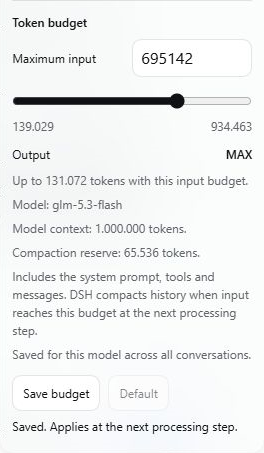

# Ngân sách ngữ cảnh DSH

Phiên bản **1.1.2**, dành cho DSH **0.2.1-rc.5**, hiện chạy tại https://dsh.hoantienmuasam.net/.

Bấm nút **% ngữ cảnh** cạnh ô chat để mở **Maximum input**. Kéo thanh hoặc nhập số token nguyên rồi chọn **Save budget**. **Default** khôi phục mặc định. Lựa chọn lưu riêng theo provider/model, dùng chung giữa các phiên.

Đầu ra mặc định **MAX**, giới hạn bởi khả năng model và phần ngữ cảnh còn lại:

```text
outputMAX = min(modelOutputCapacity, contextWindow - inputBudget - compactionReserve)
```

Đầu vào tính cả system prompt, công cụ và tin nhắn. Bộ nén gốc kiểm tra ngân sách ở bước xử lý tiếp theo. Lưu cấu hình không ép nén ngay và không tự bật lại tính năng nén nếu trước đó đã tắt.



## Giới hạn model

[Thông số và nguồn](../../docs/model-capacities.md) giải thích mức 1M và giới hạn đầu ra riêng. [Cấu hình mẫu](../../docs/tlpro-model-capacities.json) chứa metadata cần ghép vào provider đang có; không chứa endpoint hoặc thông tin đăng nhập. Không thay toàn bộ provider bằng mẫu này.

`modelInputCaps` là từ điển giới hạn đầu vào độc lập. Khóa là `JSON.stringify([provider, model])`. Ba model GPT trong mẫu dùng trần 922.000 token đầu vào. Popup, kiểm tra lưu, đầu ra MAX và ngưỡng nén cùng dùng giới hạn này.

Nếu cổng `/models` không trả thông số, cấu hình rõ `contextWindow` và `maxTokens` cho từng model trong Settings của `llm-pi-ai`. Mức dự phòng 262.144 token không phải thông số vật lý của mọi model. Plugin từ chối chỉnh sửa khi metadata không hợp lệ; không tự nâng dung lượng model chưa biết.

## Cài vào DSH 0.2.1-rc.5

1. Đặt thư mục này ở vị trí cố định trên máy chủ.
2. Kiểm tra hai bản vá tích hợp gốc, sau đó áp dụng:

   ```sh
   node patch-native.mjs --root /path/to/dsh/node_modules
   node patch-native.mjs --root /path/to/dsh/node_modules --apply
   ```

3. Cài bundle bằng Plugin Manager từ đường dẫn thư mục này, rồi khởi động lại DSH khi các phiên đã rảnh để backend nạp bản vá.
4. Ghép metadata model và `modelInputCaps` theo mẫu, tải lại trình duyệt và kiểm tra popup.

Bản vá xác minh phiên bản và SHA-256 nguồn gốc trước khi ghi; sao lưu, chạy lặp lại được và từ chối thay đổi không liên quan. Nâng DSH cần kiểm tra lại bản vá. `startup.sh` là launcher Railway hiện tại, phụ thuộc wrapper Safari auth riêng trên volume; không dùng nguyên launcher đó cho máy Windows hoặc máy chủ chưa có wrapper.

Khôi phục: tắt bundle, chạy `node patch-native.mjs --root <runtime-node_modules> --restore --apply`, rồi khởi động lại khi rảnh. Lịch sử chat không bị sửa.

## Kiểm thử

Cần Node.js 24 trở lên:

```sh
cd plugins/dsh-context-auto
npm install --ignore-scripts
npm test
```

Runtime kiểm thử được ghim tại `@deepseek-ai/dsh@0.2.1-rc.5`. Fixture lấy từ package đã cài và chép sang thư mục tạm trước khi vá; không sửa runtime đang cài. Bộ kiểm thử dùng model/summarizer giả, không gọi API tính phí.

13 kiểm thử bao gồm kiểm tra/khôi phục bản vá, ngưỡng nén tuyệt đối trên engine gốc, ngân sách 1M, trần đầu vào GPT, xung đột revision, cách ly model, middleware đầu ra MAX và thao tác popup. Bản triển khai đã kiểm tra lưu 800.000 token, tải lại trang, khôi phục mặc định và giữ các bản sửa Safari/hiệu năng có sẵn. Chưa chạy yêu cầu thực tế dài gần 1M token qua TLPRO.

`DSH_TEST_RUNTIME_PACKAGE` có thể trỏ đến `package.json` chứa runtime đã cài; `DSH_TEST_NATIVE_ROOT` có thể trỏ đến thư mục fixture gốc rc.5. Hai biến này dành cho môi trường kiểm thử đã chuẩn bị sẵn.
